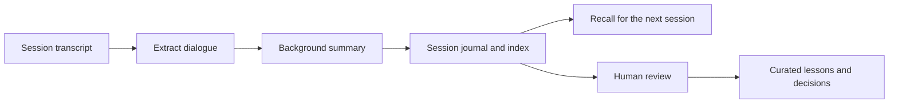

# Case study: preserving decisions across AI-assisted operations

## The problem

Conference work spans many conversations and tools. A single planning session can contain a request, several possible approaches, a decision, and unfinished follow-up. A short memory summary can flatten these distinctions. Later work may proceed as if an option was approved when it was only discussed.

I organized event work into a shared workspace and added a journal prototype to preserve the difference between discussion and commitment.

## Workspace design

The private workspace combines common agent instructions, task-specific skills, planning outputs, and event-level records. Its operational scope covers speaker preparation, sponsorship, participant communication, and reporting. Shared procedures can move into the companion engine while event-specific material stays with the event.

The important ownership boundary is the event. People collaborating on the same event need a common record; a separate copy for each operator makes it harder to reconcile the current state.

## Memory design in the private project

Implementation files include hooks, a transcript extractor, a background summary worker, journal search, recall, and backfill scripts. The journal design record was still marked proposed. It is therefore presented here as an implemented prototype, without a claim of mature deployment or verified reliability.

The journal distinguishes the request, reasoning history, confirmed decisions, unresolved or rejected alternatives, outputs, and handoff notes. A separate lessons log captures reusable observations; architecture records document larger decisions. These stores serve different purposes and should not silently overwrite one another.

## Public reconstruction

The public Python demo starts after summarization: it consumes explicitly structured synthetic records. This keeps the example reproducible without uploading transcripts to a model or requiring connected business accounts.

One example record claims to be confirmed but has no human decision reference. The demo leaves it open. A task depending on that record remains blocked. The generated handoff preserves approved and rejected alternatives alongside unresolved questions.

The approval fields are illustrative input, not a security boundary. A production implementation would need trusted approval provenance and access controls; anyone editing a local fixture can edit these fields.

## Design trade-offs

| Decision | Benefit | Cost or limitation |
| --- | --- | --- |
| A journal per session | Preserves how work reached its current state | Requires retrieval and curation as history grows |
| Automated capture hooks | Reduces reliance on remembering a manual ritual | Crashes and tool format changes require recovery paths |
| Separate approved, open, and rejected items | Makes decision status inspectable | A summarizer can still misclassify the conversation |
| Event-level shared state | Gives collaborators a common working context | Requires ownership and access management |
| Separate session history from durable lessons | Avoids treating every activity as a permanent rule | Useful lessons still need review and promotion |

## My contribution and evidence boundary

I built and organized the operations workspace and session-journal prototype with AI coding assistants. The public description is based on the private workspace's instructions, scripts, and design records, rather than an assertion that every proposed workflow was fully deployed.

The public tests verify the new demo's handling of decision records and task dependencies. They do not validate the private summarizer's accuracy, business integrations, or historical business impact.

## What I learned

Memory needs to preserve the status of a statement, not only its text. A useful handoff tells the next operator what was decided, why an option was rejected, and which questions are still open. Making those distinctions visible is an engineering choice as much as a prompting choice.
